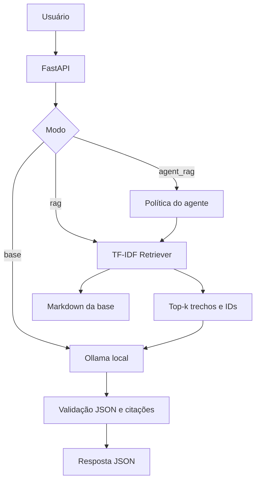

# Arquitetura

1. Usuário envia pergunta/modo.
2. Base chama o modelo sem recuperação; RAG recupera trechos; agente RAG aplica política estrita.
3. TF-IDF seleciona até três trechos.
4. Prompt inclui evidências e identificadores.
5. Ollama gera resposta JSON; o sistema valida estrutura e filtra citações.

A aplicação é local e demonstrativa. Não exponha publicamente sem autenticação, limites de requisição e controles de privacidade.
